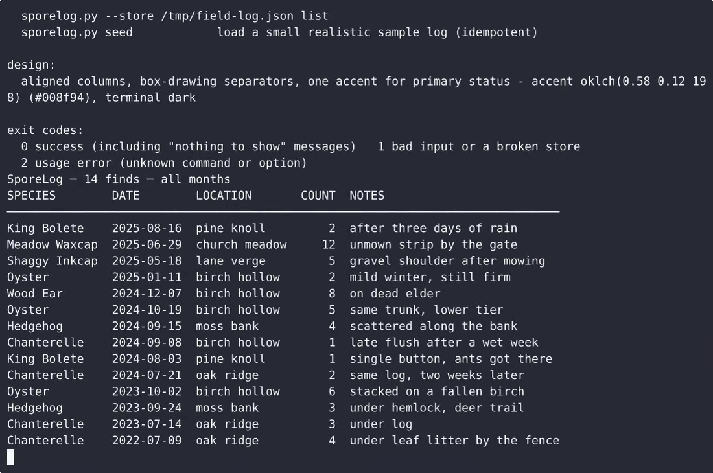
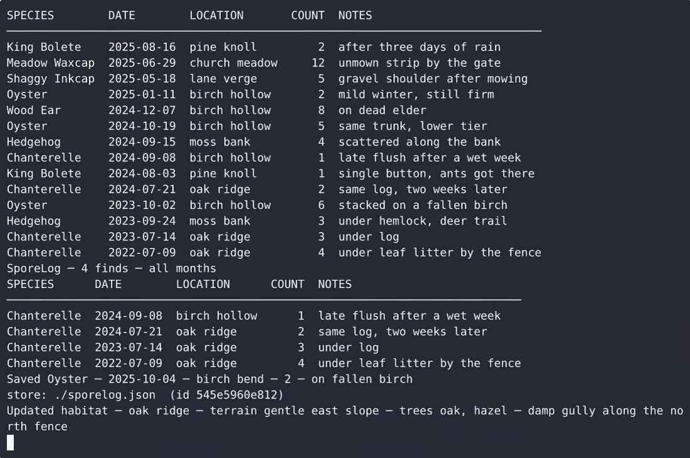

# SporeLog — complete Full-stack app command-line tool example app

Clone it. Run it. Own it. **SporeLog** is a complete, Apache-2.0-licensed command-line tool in Full-stack app — full source, demo data included. SporeLog is a single-file, standard-library-only Python command-line tool that lets one forager keep a local mushroom foraging log: each sighting records species, date, habitat, count and notes; habitat notes describe…. Self-host SporeLog on your own infrastructure, or open it on [cenius.ai](https://cenius.ai/marketplace/p/sporelog?ref=gh&utm_campaign=sporelog-webapp) to request changes and get a SporeLog fresh build.


[](LICENSE)  [](https://cenius.ai)

[](https://cenius.ai/marketplace/p/sporelog?ref=gh&utm_campaign=sporelog-webapp)

> **▶ [Open & edit in cenius.ai](https://cenius.ai/marketplace/p/sporelog?ref=gh&utm_campaign=sporelog-webapp)** — one click to an editable workspace: describe changes in plain English, get an instant preview, one-click deploy and host. Modifications made on the platform come with full rebrand & relicense rights.

_Local clone? See [Quick start](#quick-start) below. cenius.ai is the zero-setup path._

## Demo


▶ **[See it in action](https://cenius.ai/marketplace/p/sporelog?ref=gh&utm_campaign=sporelog-webapp)** — full demo on the project page · [MP4](.github/media/demo.mp4)

## Screenshots

 

## Features

- Foraging log entry
- Habitat notes
- Seasonal recurrence tracking

## Quick start

```bash
./install.sh   # installs dependencies + seeds demo data
```

See [`INSTALL.md`](INSTALL.md) for full setup and usage instructions.

## Usage guide

Every example below is copy-pasteable from the repository root and uses the
default store (`./sporelog.json`) unless it says otherwise.

### 1. Log a find

```bash
python3 sporelog.py add --species Chanterelle --date 2025-07-14 \
  --location "oak ridge" --count 3 --notes "under log"
```

```
Saved Chanterelle ─ 2025-07-14 ─ oak ridge ─ 3 ─ under log
store: ./sporelog.json  (id 8c1d90f2a4b3)
```

- `--species` and `--date` are required; the date must be a real ISO date
  (`YYYY-MM-DD`, zero padded).
- `--location`, `--count` and `--notes` are optional; `--count` defaults to 1
  and must be a whole number of 1 or more.
- A bad argument prints one line and exits 1 **without writing the store**:

```bash
python3 sporelog.py add --species Chanterelle --date 2025-13-40
## error: --date '2025-13-40' is not a valid YYYY-MM-DD date (example: 2025-07-14)
```

### 2. Read the log back

```bash
python3 sporelog.py list
```

```
SporeLog ─ 14 finds ─ all months
SPECIES        DATE        LOCATION       COUNT  NOTES
───────────────────────────────────────────────────────────────────────────────
King Bolete    2025-08-16  pine knoll         2  after three days of rain
Meadow Waxcap  2025-06-29  church meadow     12  unmown strip by the gate
```

- Newest first; long notes are shortened with `…` in the table — use `--json`
  for the full text.
- Empty log: `No entries yet.` plus the example `add` command.
- Filters that match nothing say so and never pretend the log is empty:
  `No entries match --species Morel. 14 finds in the log; drop a filter or run …`

#### Narrow by species

_Full guide: [`USAGE.md`](USAGE.md)_

## Architecture

A self-contained Full-stack app project (24 files): top-level directories include `demo/`, `tests/`. `./install.sh` gets you from a fresh clone to a running instance with sample data in a single step. Step-by-step setup guide: [`INSTALL.md`](INSTALL.md).

## FAQ

### How do I run SporeLog on my own server?

Everything you need ships in this repo: clone it, run `./install.sh` to install dependencies and seed demo data, then follow [`INSTALL.md`](INSTALL.md) to start it. No external services required.

### How do I make SporeLog my own brand?

Yes — and the easiest way is [remixing it on cenius.ai](https://cenius.ai/marketplace/p/sporelog?ref=gh&utm_campaign=sporelog-webapp): modifications made on the platform come with full rebrand and relicense rights over your derivative.

### Is SporeLog free for commercial use?

Yes — Apache-2.0-licensed, so commercial use, modification, and distribution are all permitted. Read the full terms in [LICENSE](LICENSE).

### What powers SporeLog under the hood?

Full-stack app. The full source in this repository is exactly what the app runs. Highlights include foraging log entry.

### Can I change SporeLog without writing code?

Describe what you want changed on [cenius.ai](https://cenius.ai/marketplace/p/sporelog?ref=gh&utm_campaign=sporelog-webapp) — no code editing needed; the platform produces a fresh build you can download and deploy.

## License & rebranding

Released under the [Apache License 2.0](LICENSE) (© 2026 Cenius AI) — free for personal and commercial use. The Cenius name/logo are trademarks (see NOTICE).

**Need a customized version?** [Remix this app on cenius.ai](https://cenius.ai/marketplace/p/sporelog?ref=gh&utm_campaign=sporelog-webapp) — modifications made on the platform come with **full rebrand & relicense rights** over your derivative.

## Built with cenius.ai

This entire application — code, design, seeded demo data — was generated on **[cenius.ai](https://cenius.ai)** from a plain-English description.

- 🚀 [Build your own app on cenius.ai](https://cenius.ai)
- 🎛️ [Remix SporeLog on the marketplace](https://cenius.ai/marketplace/p/sporelog?ref=gh&utm_campaign=sporelog-webapp) — open it in a workspace, prompt for changes, and ship your own version.

More open-source apps: [the Cenius-ai catalog](https://github.com/Cenius-ai) · [showcase index](https://github.com/Cenius-ai/showcase)
